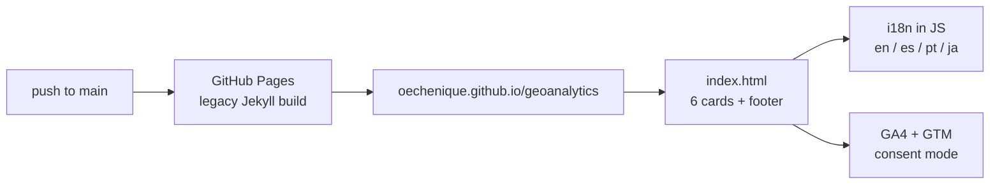

# geoanalytics

 · [🇦🇷 Español](README.es.md)

**A static landing page that collects my GIS-with-Python repos in one place: six cards, one per topic, each linking to its repository. Live at [oechenique.github.io/geoanalytics](https://oechenique.github.io/geoanalytics/).**

There is no Python in this repo: the code lives in the repos it links to. It is a single `index.html` with no build step and no dependencies.

## What it links to

| Card | Repository |
|---|---|
| Python Basics | [`python-gis-basics`](https://github.com/oechenique/python-gis-basics) |
| Geocoding | [`Geocoding`](https://github.com/oechenique/Geocoding) |
| Spatial Analysis | [`analytics`](https://github.com/oechenique/analytics) |
| Data Engineering | [`data-engineering`](https://github.com/oechenique/data-engineering) |
| Remote Sensing | [`remote_sensing`](https://github.com/oechenique/remote_sensing) |
| AI & Predictions | [`ai-predictions`](https://github.com/oechenique/ai-predictions) |

## How it works

- **Deploy**: GitHub Pages builds from `main`, folder `/`, with no workflow of its own. Every merge to `main` republishes the site. Anything at the root that doesn't start with `.` or `_` is served too (for example, this README at `/README.md`).
- **Language**: the cards and footer switch between English, Spanish, Portuguese and Japanese. The order is `?lang=xx` first, then the last choice saved in `localStorage`, then the browser language. Spanish wins over Portuguese and Japanese when the browser lists several.
- **Analytics**: Google Analytics 4 through `gtag.js`, plus a Google Tag Manager container. Consent mode defaults are set *before* any tag is configured: denied in the EU, granted elsewhere.

## Structure

| Path | What's there |
|---|---|
| `index.html` | The whole site: markup, CSS, i18n and tracking |
| `img/` | Card backgrounds, the Open Graph image and social icons (`.webp`) |
| `docs/img/` | The screenshot in this README |

## Run it locally

Open `index.html` in a browser. To preview another language, add `?lang=es` (or `pt`, `ja`) to the URL.

## Limits

- The *AI & Predictions* card points to a repo that only has a README so far.
- Tracking is configured in the GTM container as well as in the page. If the container also fires a GA4 tag with the same ID, each visit is counted twice. That can only be checked in the GTM UI.

## License and attribution

- Code (`index.html`): [MIT](LICENSE).
- Images in `img/` and `docs/img/`: **⚠ PENDING: source to be confirmed (own / AI-generated / third party)**.
- Social icons are the trademarks of their respective platforms.
